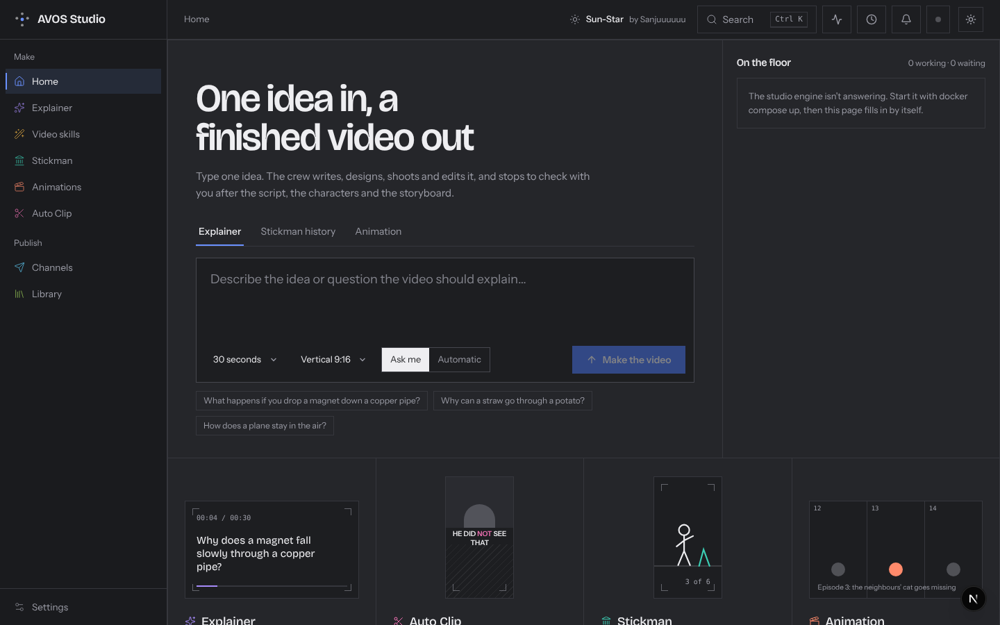
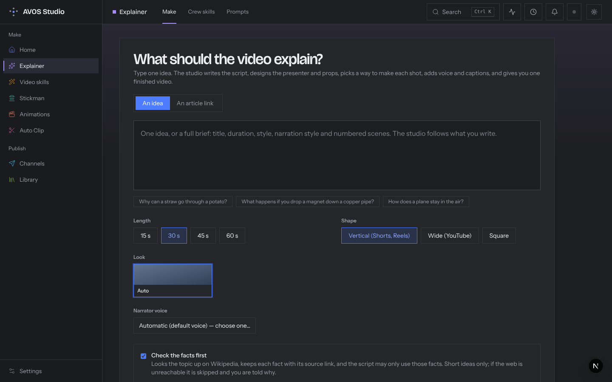
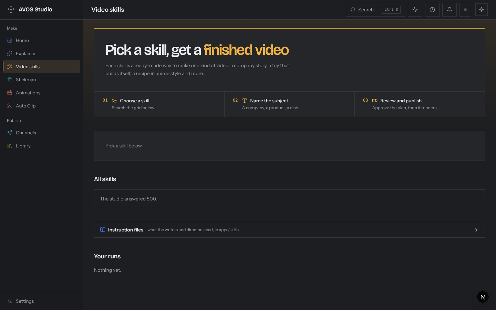
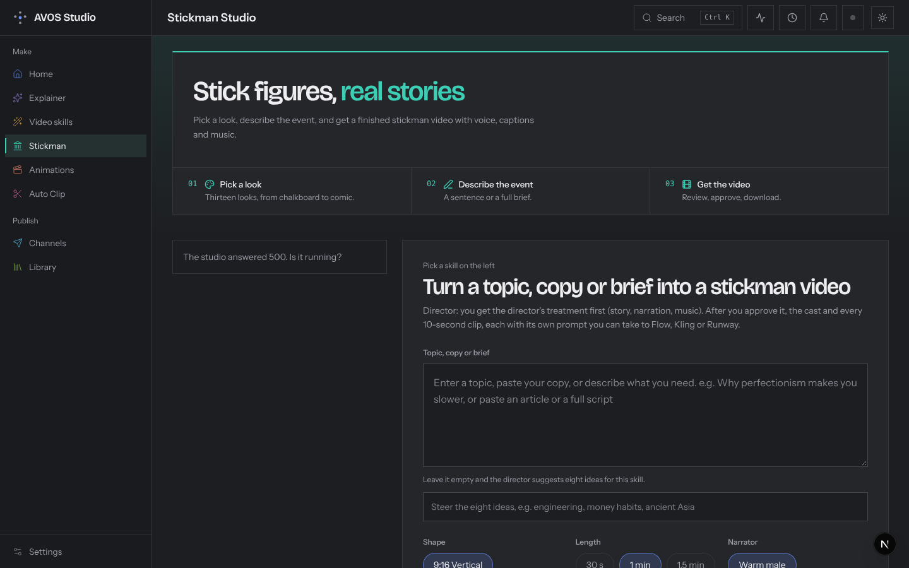

<div align="center">

<h1>AVOS Studio</h1>

<p><b>One idea in, a finished video out.</b><br>
A local studio for faceless shorts: explainers, stickman stories, animated series and auto-clipped highlights,<br>
written, drawn, voiced, cut and posted from one desktop app.</p>

<p>
<a href="LICENSE"></a>


</p>

</div>

<p align="center"></p>

## What it is

You type a topic, paste a link or drop a long video. AVOS writes the script, designs the characters, draws or generates
every shot, adds a voice, music and captions, renders the video and, if you want, posts it to your channel. It stops to
check with you after the script, the characters and the storyboard, so nothing goes out that you have not seen.

Everything runs on your own computer. It works with free and local models out of the box (Ollama, Pollinations,
Cloudflare Workers AI free tier) and gets better with any key you add: Groq, Gemini, OpenAI, Anthropic, OpenRouter,
fal.ai, Replicate, Stability or your own ComfyUI GPU server.

## What you can make

| Studio | What it does |
|---|---|
| **Explainer** | A question or topic becomes a 30-90 s explainer: research, script, scene plan, generated shots, narration with word-timed captions and music. Ask-me mode pauses for your review at each stage; Automatic runs straight through. Crew skills and prompt presets live in tabs on the same page. |
| **Video skills** | Ready-made formats you fill with one input: recipe-to-cooking scene, ASMR cooking and cutting, company story, film-style ads, motion graphics, paper art and more. Each skill writes the prompts, makes the key frame and the clip. |
| **Stickman** | Hand-drawn stickman stories and history shorts with consistent characters, styles you can pick from references, and camera moves. |
| **Animations** | Series and short films: a series bible, recurring characters with locked looks and voices, locations, breakdown, storyboard and shot-by-shot rendering in 2D, 3D or paper styles. |
| **Auto Clip** | A long video, a YouTube link or a live stream becomes vertical shorts. Finds the best moments from loudness, shouting, gunfire and explosions in games, motion and scene cuts, exciting words, the replay graph and live chat; trims each clip to clean sentence boundaries with a hook in the first seconds; reframes to 9:16 by following faces or the action; adds animated captions, titles and post cards. Also: Explore trending, Live streamers and a channel autopilot. |
| **Channels** | Connect YouTube and other accounts, schedule and post, with titles, descriptions and hashtags written to a checklist that favours hooks and comments. |
| **Library** | Every video, clip and picture you made, with its prompts, so you can remake or post it later. |
| **Settings** | API keys with a **Test** button beside each provider (one free, read-only call that tells you whether the key works), your GPU server, your own models and ComfyUI workflows, and usage and cost. |

<table>
<tr>
<td width="50%"></td>
<td width="50%"></td>
</tr>
<tr>
<td width="50%"></td>
<td width="50%"></td>
</tr>
</table>

## Highlights

- **Human in the loop.** Durable workflows (Temporal) pause for your approval and resume exactly where they stopped, even after a restart.
- **Free first.** Ollama for text, Pollinations and Cloudflare for pictures, faster-whisper for captions and free Edge voices for narration. Paid providers are optional.
- **Bring your own GPU.** Point Settings at a ComfyUI server and the studio routes image and video jobs to it; drop in your own workflow JSON.
- **One key is enough to start.** Paste a text key (Groq, Gemini...) and it writes every job; paste a fal.ai key and it draws pictures and makes Seedance, Kling or Wan video. Home shows *Your setup*: which provider does writing, pictures, video and voice, and the one key that would help most.
- **Provider fallback.** When a free daily quota runs out, the job moves to the next provider you have set up instead of failing.
- **Skills you can edit.** Writers, directors and checkers are plain `SKILL.md` files in [`apps/skills`](apps/skills). Change the text and the next run follows it.
- **Live progress.** Every stage streams to the app as it happens; the top bar shows what is working and what needs you.

## Requirements

- Windows 10/11, macOS or Linux
- [Docker Desktop](https://www.docker.com/products/docker-desktop/) (for the API, worker, database and studio engine)
- [Node.js](https://nodejs.org/) 20 or newer (for the desktop app)
- 8 GB RAM minimum, 16 GB recommended. An NVIDIA GPU is optional and only needed for local image and video models.
- Optional: [Ollama](https://ollama.com/) for free local text AI (`ollama pull qwen2.5:7b`)

## Quick start

```bash
git clone https://github.com/sanjithrana/avos---sun-stars.git
cd avos---sun-stars/apps

cp .env.example .env              # optional: add keys here or later in Settings
docker compose up -d --build      # API :8001, studio engine :8020, Temporal UI :8233

cd desktop
npm install
npm run dev                       # open http://localhost:3000
```

Then open **Settings → API keys**, paste the keys you have, press **Save** and then **Test** beside each one. A green line
means the provider accepted it; a red line says what to fix.

**Windows without Docker for the studio engine:** `apps\start-animations.bat` creates a Python environment and starts the
engine on http://127.0.0.1:8020 (keep the window open).

More detail: [apps/RUNBOOK.md](apps/RUNBOOK.md) and the architecture notes in [docs/avos-architecture](docs/avos-architecture).

## Configuration

| Setting | Where | Notes |
|---|---|---|
| Text AI | Settings → API keys, or `apps/.env` | `OLLAMA_BASE_URL` + `OLLAMA_MODEL` for local; or `GROQ_API_KEY`, `GEMINI_API_KEY`, `OPENAI_API_KEY`, `ANTHROPIC_API_KEY`, `OPENROUTER_API_KEY` |
| Pictures and video | same | `FAL_KEY`, `REPLICATE_API_TOKEN`, `STABILITY_API_KEY`, `CLOUDFLARE_ACCOUNT_ID` + `CLOUDFLARE_API_TOKEN`, `POLLINATIONS_TOKEN` |
| Your GPU | Settings → GPU | ComfyUI address and the workflows to use |
| Your own models | Settings → Models | Any fal, Replicate, ComfyUI or OpenAI-compatible endpoint |

A key saved in Settings wins over the same name in `apps/.env`. Keys stay on your computer and are never committed.

## FAQ

**The app says "Cannot reach the API".** The Docker services are not running. Run `docker compose ps` in `apps`; `api`
should be *healthy*. `docker compose logs api` shows why it stopped.

**A Test button says the key was refused.** Copy the key again from the provider's page (the link icon beside each name
opens it), Save, and Test again. "Over the rate limit" means the key is fine and you should wait a minute.

**Ollama test says the model is not downloaded.** Run the `ollama pull` command shown in the message.

**Auto Clip face tracking is off.** The YuNet face model downloads on first use. Without internet, download it once from the
link shown in Auto Clip's status and place it in `apps/animation_studio/studio/autoclip/assets/face_yunet.onnx`.

**Can I use it without any paid key?** Yes. With Ollama and the free picture providers everything works; paid providers
only make some steps faster or sharper.

## Responsible use

AVOS is a tool. You are responsible for what you make and publish with it.

- Clip, remix and repost only videos you own or have permission to use, and follow each platform's terms. Auto Clip refuses
  sources from DRM streaming services.
- Generated characters are original. Do not prompt for trademarked characters, logos or a living artist's identity.
- Label AI-generated or synthetic content where the platform or the law asks you to.
- Respect the terms of every model and API provider you connect.

## Licence

AVOS Studio is released under the [Apache License 2.0](LICENSE). See [NOTICE](NOTICE).

It builds on open-source work, used under their own licences, with the full notices kept next to the code:
[AutoClip](https://github.com/zhouxiaoka/autoclip) (MIT),
[NeonClipping](https://github.com/iamajmeena/neonclipping) at commit c0edf73, its last MIT version,
ReelMimic (MIT), [Ootto content skills](https://github.com/Ootto-AI/claude-content-skills) (MIT),
animation-skills (MIT), lemo-opuscar (MIT), three.js (MIT), Twemoji (CC BY 4.0), the bundled caption fonts (SIL OFL 1.1),
YuNet from OpenCV Zoo (MIT), and libraries installed with pip and npm such as FastAPI, Next.js, yt-dlp,
youtube-transcript-api and OpenCV. The interface follows the *unslop* design rules by Damir Sokolovsky
([@heydamir](https://x.com/heydamir)), CC BY 4.0.

All product names, logos and brands mentioned here belong to their owners and are used only to identify compatible services.
