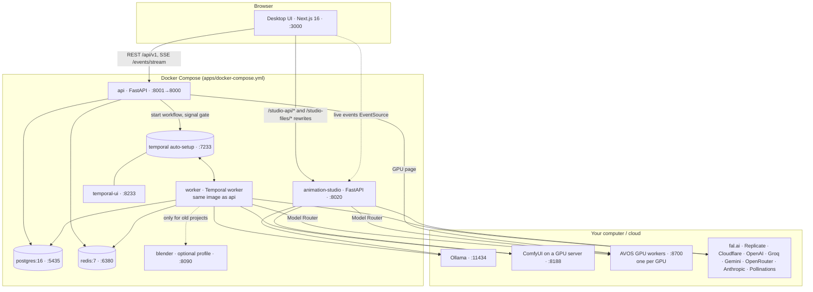
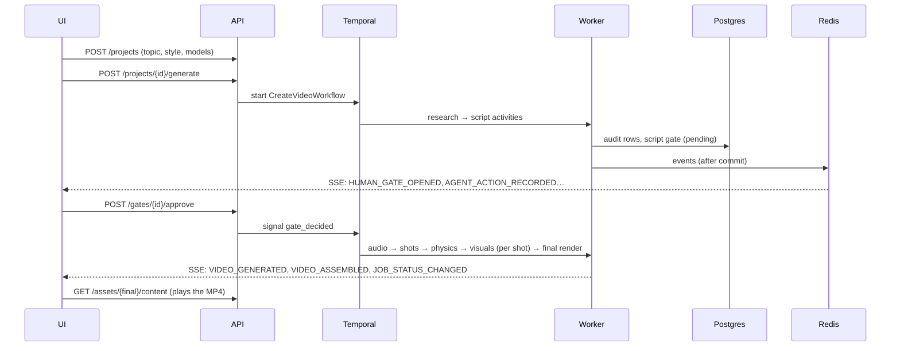

# 1. System overview

## Services



| Service | Code | Role |
|---|---|---|
| **desktop** | `apps/desktop` | Next.js app: Facts, Studio, Animations, Models, Settings pages. Runs with `npm run dev` (not in Compose). |
| **api** | `apps/api` | FastAPI. Projects, jobs, gates, shots, QA/repair, assets, models catalog, settings, live events (SSE). Starts and signals Temporal workflows. Runs Alembic migrations on start. |
| **worker** | `apps/api/src/temporal` | Temporal worker executing `CreateVideoWorkflow` and its activities (research, script, audio, shots, Blender proxy, visuals, final render). Same image and env as the API. |
| **animation-studio** | `apps/animation_studio` | ReelMimic's reference-video-to-animation workflow in Python: own REST + SSE API, project folders on disk, AI crew, 2D renderer, review gates, AI finish. |
| **gpu worker** (on GPU machines) | `apps/gpu_worker` | Runs generations the Model Router sends it (ComfyUI / Wan2GP / Diffusers), keeps models loaded, reports GPU, VRAM, queue. Not part of the main Compose file: run it on each GPU machine (see [10](10-model-fabric-and-gpu-workers.md)). |
| **postgres** | image `postgres:16` | System of record for Facts: projects, jobs, gates, shots and versions, world states, generations, QA, repairs, assets, audit trail. |
| **redis** | image `redis:7` | Pub/sub event bus fanning live events out to SSE subscribers (not durable). |
| **temporal / temporal-ui** | Temporal auto-setup | Durable workflow engine for the Facts pipeline; UI at http://localhost:8233. |
| **blender** (optional) | `apps/blender_service` | Headless Blender renderer for the legacy "Blender" video choice. Only with `--profile blender`. The physics-proxy step uses a built-in mock renderer unless `BLENDER_SERVICE_URL` is set. |

## Tech stack

| Layer | Technology |
|---|---|
| UI | Next.js 16 (App Router, Turbopack), React 19, TypeScript, Tailwind CSS 4, TanStack Query, lucide icons, opencc-js (Chinese conversion for Animations) |
| API | Python 3.11, FastAPI, Pydantic v2, SQLAlchemy 2 (async, psycopg), Alembic |
| Orchestration | Temporal (Python SDK) |
| Events | Redis pub/sub → Server-Sent Events |
| Media | ffmpeg / ffprobe, Edge TTS (narration), skia-python (Animations renderer), Pillow |
| AI | Pluggable providers: Ollama, OpenAI-compatible APIs, Groq, Gemini, OpenRouter, Anthropic; fal.ai, Replicate, Cloudflare Workers AI, Pollinations, Stability; ComfyUI on your GPU |
| Tests | pytest (+ pytest-asyncio), Playwright (UI end to end) |

## Repository layout (`apps/`)

```
apps/
├─ desktop/                 Next.js UI (app/, components/, hooks/, lib/api/, types/, tests/e2e/)
├─ api/                     FastAPI service + Temporal worker
│  ├─ src/routes/           HTTP endpoints
│  ├─ src/services/         business logic (generation, shots, QA, repair, render, settings…)
│  ├─ src/repositories/     database access
│  ├─ src/database/models/  SQLAlchemy tables
│  ├─ src/temporal/         CreateVideoWorkflow + activities + worker
│  ├─ src/core/             asset registry, event bus/outbox, Blender client
│  ├─ alembic/              migrations
│  └─ tests/                API + integration tests
├─ agentic_core/            the "brain", shared by api and worker
│  ├─ director/             Studio Director (next-step policy), context manager, memory
│  ├─ tool_gateway/         gateway, permissions, constitution, tools
│  ├─ models/               llm/, image/, video/, catalog.json, catalog.py, fal_client.py, custom_models.py
│  ├─ model_fabric/         Model Router, GPU workers, scheduler, limits, telemetry, learned performance
│  ├─ pipelines/            script, audio (TTS, timings, beats), shot (prompt compiler), blender planner, qa, render
│  ├─ shotspec/ world_state/  ShotSpec builder, continuity rules
│  ├─ agents/repair/        failure classifier + repair ladder
│  ├─ settings_store.py     shared settings (keys, GPU server, your models)
│  └─ styles.py             style presets (viral_3d, storybook)
├─ packages/contracts/      Pydantic contracts shared by every layer (project, job, shotspec, qa, events…)
├─ tool_gateway/            tool registry + JSON-schema validation (framework-level)
├─ animation_studio/        Animations service (studio/, reelmimic_assets/, tests/)
├─ gpu_worker/              GPU worker service for GPU machines (worker/, adapters/, Dockerfile, README)
├─ comfyui_workflows/       your exported ComfyUI workflows (<model id>.json) + README
├─ blender_service/ blender_assets/   optional Blender renderer + Mixamo assets
├─ music/                   background music + whoosh SFX library
├─ reelmimic/               the original ReelMimic repo (reference; its assets are vendored into animation_studio)
├─ docker-compose.yml  RUNBOOK.md  start-animations.bat/.sh
```

## How a request flows (Facts)



## Ports

| Port | What |
|---|---|
| 3000 | Desktop UI |
| 8001 | AVOS API (`/api/v1`, `/health`) |
| 8020 | Animation Studio (`/api`, `/files`) |
| 8233 | Temporal UI |
| 7233 | Temporal gRPC |
| 5435 | Postgres (inside Compose: 5432) |
| 6380 | Redis (inside Compose: 6379) |
| 8090 | Blender service (optional) |
| 11434 | Ollama on your PC (reached from Docker as `host.docker.internal`) |
| 8188 | ComfyUI on your GPU server |
| 8700+ | AVOS GPU workers (one per GPU) |
