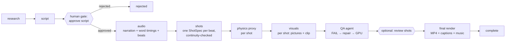
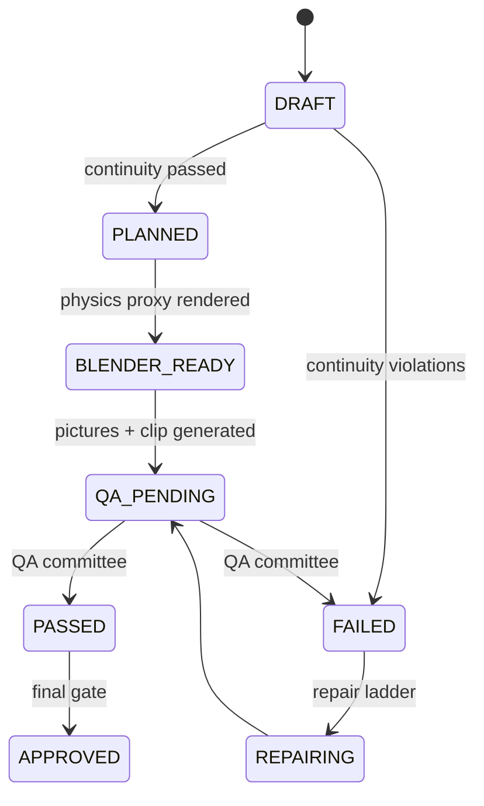
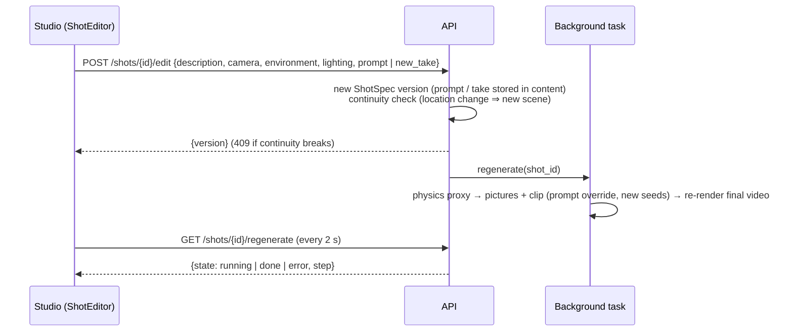

# 2. The Facts pipeline

A Facts project goes from a topic to a narrated, captioned MP4 through one durable Temporal workflow,
`CreateVideoWorkflow` (`api/src/temporal/workflows/create_video.py`). Each stage is an activity that runs in the
worker, commits its results to Postgres and then publishes live events.

## Stages

| Stage (project status) | Activity | What happens | Main code |
|---|---|---|---|
| `researching` | `research_activity` | The Director checks memory, then the Research agent gathers facts for the topic with the project's text model. | `temporal/activities/research.py`, `agentic_core/tool_gateway/tools/research_topic.py` |
| `researching` → `awaiting_approval` | `generate_script_activity` | The Narrative agent writes the script (scenes with narration and visual descriptions, shaped by the style preset), validated, then a **human gate** (`script_approval`) is opened. | `pipelines/script/generator.py`, `validator.py`, `services/human_gate_service.py` |
| `awaiting_approval` | — | The workflow waits on `workflow.wait_condition()` (no polling) until the `gate_decided` signal arrives from `POST /gates/{id}/approve` or `/reject`. | `create_video.py` |
| `generating_audio` | `generate_audio_activity` | Narration with Edge TTS (or mock); word timings from the voice (or Whisper); sentence timestamps; **semantic beats**. Stored as an `audio` asset. | `pipelines/audio/*`, `services/audio_service.py` |
| `planning_shots` | `plan_shots_activity` | One **ShotSpec** per beat (camera, lighting, characters, environment, style), each validated against the **WorldState** for continuity. | `services/shot_planning_service.py`, `agentic_core/shotspec`, `world_state/continuity.py` |
| `planning_shots` | `blender_activity` | **Physics before pixels:** a physics proxy (depth / normal / canny / mask passes + scene layout) for every planned shot. Mock renderer unless a Blender service is configured. | `services/blender_stage_service.py`, `pipelines/blender/planner.py`, `core/blender/client.py` |
| `generating_visuals` | `start_visuals_activity`, then `generate_shot_visual_activity` per shot | For each shot: 3 picture candidates from the project's image model, and a clip for candidate 0 from the project's video model (or an avatar clip). One shot failing doesn't stop the video: it falls back to an animated still and a warning is shown. | `services/video_generation_service.py` |
| `generating_visuals` | `qa_settings_activity`, `qa_repair_activity` per shot | QA agent checks every shot; FAIL → repair agent (new seeds / corrected prompt) → regenerate → QA again, up to the generation limit; then `NEEDS_REVIEW`. Shots in parallel. See [11](11-scheduler-qa-storage-downloads.md). | `temporal/activities/qa.py` |
| `awaiting_review` (optional) | `shots_review_gate_activity` | With "review shots" on: a `final_approval` gate; the Studio shows **Review the shots**; approve → render, reject → stop. | `temporal/activities/qa.py`, `ShotsReview.tsx` |
| `rendering_video` | `render_final_video_activity` | Final MP4: each shot's clip (fitted to its exact length) or its picture with a camera move, cut on the narration beats, narration mixed in, word-by-word captions burned in, background music and whooshes. Full HD (1080×1920 for 9:16). | `services/final_render_service.py`, `pipelines/render/assemble.py`, `captions.py` |
| `complete` | `finalize_job_activity` | The job's `output_payload` holds research notes, audio, shots, physics, visuals, `final_video` and warnings. | `services/job_lifecycle_service.py` |

Project statuses (`api/src/domain/projects/status.py`): `planning → researching → awaiting_approval →
generating_audio → planning_shots → generating_visuals → (awaiting_review) → rendering_video → complete`, plus `rejected` and `failed`.

## Shots, versions and the world state

- **Shot** (`shots`): a position in the video (`shot_index`, beat, start/end time) with a `current_version`.
- **ShotSpec version** (`shot_versions`): immutable content (`packages/contracts/shotspec.py` → `ShotContent`) plus a
  content hash, status, continuity report, physics proxy and generation pointers. Any change makes a new version
  (`parent_version` links them); identical content is a no-op.
- **WorldState** (`world_states`): what is true after each shot (characters' clothing/position/emotion, objects,
  location, time of day, weather, style). `validate_continuity` checks a shot against the world right before it,
  for example a location jump inside a scene or a style change.
- **Prompt compiler** (`pipelines/shot/prompt_compiler.py`): turns a ShotSpec into the picture prompt plus a
  deterministic seed per candidate.

## Pictures and clips for a shot

`VideoGenerationService.generate` (`api/src/services/video_generation_service.py`):

1. Idempotency: the key is derived from shot, version, content hash and physics proxy; a repeat returns the cached
   result.
2. Image provider = the project's choice; if the video choice animates pictures and no image provider was chosen,
   the free picture chain is used.
3. For each of 3 candidates: compile the prompt (or use the prompt written in the Studio), make a thumbnail with the
   image provider, store `video_candidate` + `video_thumbnail` assets.
4. Candidate 0 also gets a clip from the video provider, as a `video_render` asset:
   - **audio-driven models** (LTX-2.3 audio-to-video, LongCat Avatar, InfiniteTalk, your avatar models) get the shot's
     slice of the narration, cut from the project's `audio` asset with ffmpeg by the shot's start/end;
   - **avatar models** get one **presenter portrait** per project (made once with the image model, stored as a
     `presenter` asset and reused so the presenter looks the same in every shot).
5. The `video_generations` row records the compiled prompt and candidates; the shot moves to `QA_PENDING`.

## QA committee and repair ladder

- **QA** (`agentic_core/pipelines/qa/committee.py`, `services/qa_service.py`): scores 6 dimensions (visual, temporal,
  geometry, identity, audio, prompt adherence). Visual and geometry are real checks today (decodes the frame; compares
  the framing with the physics proxy); the other four are placeholders. Results go to `qa_results`.
- **Repair** (`agentic_core/agents/repair/classifier.py`, `services/repair_service.py`): classifies the failure and
  climbs a bounded ladder: **MICRO** (seed nudge) → **MACRO** (prompt correction) → **HUMAN_REQUIRED**. The attempt
  count is derived from `repair_plans` rows, so restarts can't lose or repeat attempts.
- **Approve** (`POST /shots/{id}/approve`): the final gate for a shot; only after a PASS.

## Editing a shot in the Studio

`POST /shots/{shot_id}/edit` (`services/shot_edit_service.py`) lets a person change what we see, the camera, the
place, the light, or the exact prompt:

- The narration and timing stay the same; only that shot is regenerated, then the final video is re-rendered and the
  job's `final_video` points to it.
- "New take" (no changes) bumps `take` in the content, which makes a new version and offsets the seeds.

## Cost and budget

Every tool call adds its cost to `projects.budget_spent` (paid clips add their real estimate, e.g. per-second fal.ai
prices). When a project has a `budget_limit`, `BUDGET_WARNING` fires at 80% and `BUDGET_EXCEEDED` at 100%.
