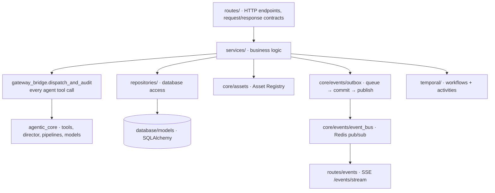
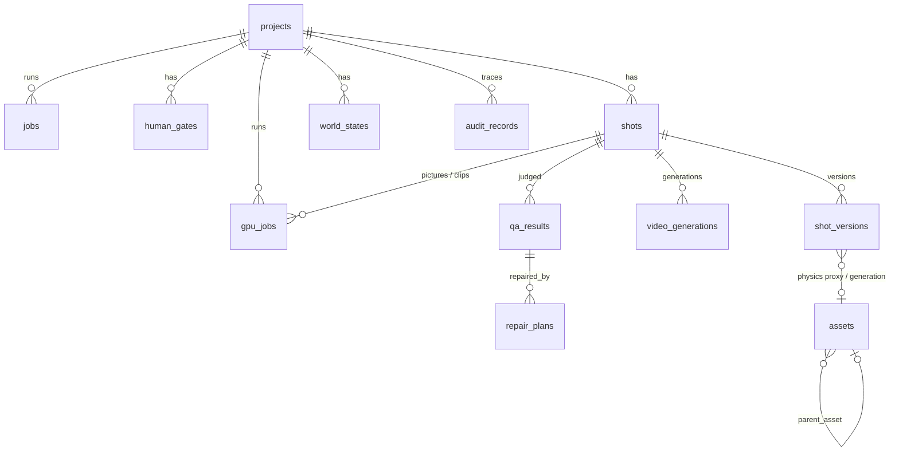
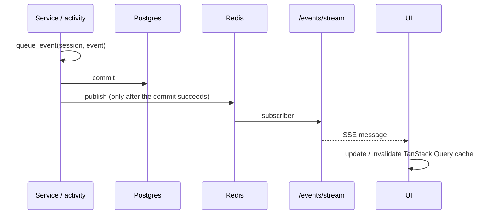

# 3. Backend API

`apps/api` is a FastAPI service (`src/main.py`) with a layered structure:

Contracts shared by every layer live in `apps/packages/contracts` (Pydantic, `extra="forbid"`): project, job,
generation, human gate, script, audio, shotspec, shot API, QA, repair, events, assets, errors.

Errors use one envelope: `{"error": {"code": "...", "message": "...", "project_id"?: "..."}}` (`src/errors.py`).

## Endpoints (`/api/v1`)

### Projects, jobs and the human gate
| Method | Path | Purpose |
|---|---|---|
| POST | `/projects` | Create a project (topic, duration, aspect ratio, budget, style, text/image/video model). Model ids are validated against the built-in providers and the models added in Settings. |
| GET | `/projects` · `/projects/{id}` | List / get |
| POST | `/projects/{id}/generate` | Start (or return the running) production job → Temporal `CreateVideoWorkflow` |
| POST | `/projects/{id}/plan` | Alias of `/generate` kept for older clients |
| GET | `/projects/{id}/jobs` | Jobs with status and `output_payload` (audio, shots, visuals, final video, warnings) |
| GET | `/projects/{id}/gates` · `/projects/{id}/gates/pending` | Human gates |
| GET | `/gates/{id}` | One gate |
| POST | `/gates/{id}/approve` · `/gates/{id}/reject` | Decide → signals the waiting workflow |
| GET | `/jobs/{job_id}` | One job |

### Shots
| Method | Path | Purpose |
|---|---|---|
| GET | `/projects/{id}/shots` | Storyboard: every shot with its current ShotSpec |
| POST | `/projects/{id}/shots` | Create a shot / new version at `shot_index` |
| POST | `/projects/{id}/shots/plan` | Director: one ShotSpec per beat (409 until audio exists) |
| GET | `/shots/{id}` | Shot detail: current spec, versions, physics assets, generation |
| POST | `/shots/{id}/validate` | Continuity check |
| GET | `/projects/{id}/world-state` | Current WorldState |
| POST | `/shots/{id}/blender` | Physics proxy for the current version (Physics agent) |
| POST | `/shots/{id}/generate` | Pictures + clip (Video agent; physics-gated; idempotent) |
| GET / POST | `/shots/{id}/qa` | QA state / run the QA committee (`?force_fail=true` for testing) |
| POST | `/shots/{id}/repair` | Next rung of the repair ladder |
| POST | `/shots/{id}/approve` | Final shot gate (needs a PASS) |
| POST | `/shots/{id}/edit` | Studio edit → new version → regenerate in the background |
| GET | `/shots/{id}/regenerate` | Progress of that regeneration |

### Models and settings
| Method | Path | Purpose |
|---|---|---|
| GET | `/models` | The model catalog (built-in + your models) with readiness, backend and what's missing |
| GET | `/settings` | Keys (masked, with source settings / .env), GPU server, your models, placeholders, workflows |
| PUT | `/settings/keys` | `{NAME: value \| null}`: any key name |
| PUT | `/settings/gpu` | `{comfyui_url, model_backend: auto \| fal \| comfyui}` |
| POST | `/settings/gpu/test` | Reaches ComfyUI `/system_stats`, reports the GPU |
| POST / DELETE | `/settings/models` · `/settings/models/{id}` | Add / remove your model (fal, Replicate, ComfyUI, OpenAI-compatible) |
| PUT / DELETE | `/settings/models/{id}/workflow` | Upload / remove a ComfyUI API workflow (built-in or your model) |
| POST | `/settings/models/{id}/test` | Text models: one short request; others: readiness |

### GPU compute (Model Fabric) — see [10](10-model-fabric-and-gpu-workers.md)
| Method | Path | Purpose |
|---|---|---|
| GET | `/gpu` | Workers (live), limits, totals, recent runs |
| GET / POST / DELETE | `/gpu/workers` · `/gpu/workers/{id}` | List / add or update / remove GPU workers |
| POST | `/gpu/workers/{id}/test` · `/load` · `/unload` · `/workflows` | Check now / warm a model / free VRAM / push ComfyUI workflows |
| GET | `/gpu/jobs` · `/gpu/performance` | Runs (`gpu_jobs`) / learned speed, success and QA |
| PUT | `/gpu/limits` · `/gpu/projects/{id}/limits` | Default / per-project generation limits |
| POST | `/gpu/route` | Router preview |

### Model downloads — see [11](11-scheduler-qa-storage-downloads.md)
| Method | Path | Purpose |
|---|---|---|
| GET | `/downloads/models/{id}?where=&path=` | Versions (with sizes), extras, recommended version, what's already there |
| GET / POST | `/downloads/browse` · `/downloads/mkdir` | Folder picker (this PC or a worker) |
| POST / GET | `/downloads` | Start a download / every download with progress (this PC + each worker) |
| DELETE | `/downloads/{where}/{id}` | Cancel or clear |

### Agents, assets, events
| Method | Path | Purpose |
|---|---|---|
| GET | `/agents/trace?project_id=` | The audited decision trace (every tool call) |
| GET | `/assets/{id}` · `/assets/{id}/content` | Asset metadata / bytes (pictures, clips, audio, final MP4) |
| GET | `/events/stream` | Server-Sent Events (all projects, or `?project_id=`) |
| POST | `/internal/temporal/hello` | Temporal smoke test |
| GET | `/health` | Liveness |

## Database (Postgres)

| Table | Key columns |
|---|---|
| `projects` | id, name, topic, duration_seconds, aspect_ratio, status, budget_limit, budget_spent, llm_provider, image_provider, video_provider, style_preset, generation_policy |
| `jobs` | project_id, job_type, status, workflow_id, temporal_run_id, input_payload, output_payload, error_message, timestamps |
| `human_gates` | project_id, gate_type (`script_approval`), status, payload (the script), comment, decided_by, workflow_id |
| `shots` | project_id, shot_index, current_version, status, beat_label, start_time, end_time |
| `shot_versions` | shot_id, version, parent_version, status, content (ShotContent JSON), content_hash, continuity, physics_proxy_asset_id, video_generation_asset_id |
| `world_states` | project_id, version, state, source_shot_id |
| `video_generations` | shot_id, version, idempotency_key, status, compiled_prompt, candidates, asset_id |
| `qa_results` | shot_id, asset_id, per-dimension scores/passes, committee_verdict, diagnostics, confidence, evidence |
| `repair_plans` | qa_result_id, shot_id, attempt, rung, failure_type, target_stage, changes, preserve, resulting asset/QA |
| `assets` | asset_id, content_hash (unique), asset_type, version, created_by, source, parent_asset, storage_path, metadata (project_id, project_ids, renderer…) |
| `gpu_jobs` | project_id, shot_id, version, task, model, backend, worker, gpu, adapter, precision, attention, offload, warm, where, status, progress, step, estimate (seconds, cost, score, reasons), gpu/wall seconds, cost, qa_score, error |
| `audit_records` | project_id, agent_decision, tool_name, tool_call_input, tool_result, duration_ms, cost, model, input/output hashes, error, retry_count |

Migrations: Alembic (`api/alembic`), run by the API container on start (`alembic upgrade head`).

## Asset Registry

`core/assets/registry.py` stores every file **content-addressed** (SHA-256) in `ASSETS_STORAGE_PATH`
(`solunex_assets` volume, `/data/assets`) with a row in `assets`. Identical bytes are stored once; a second project
that produces the same bytes (e.g. the same narration) is added to the row's `project_ids`, so per-project lookups
still find it. Asset types include `audio`, `physics_proxy`, `blender_depth|normal|canny|mask`, `video_candidate`,
`video_thumbnail`, `video_render`, `video_generation`, `presenter`, `final_video`.

## Live updates (events)

Event types (`packages/contracts/event.py`) include `PROJECT_CREATED`, `SCRIPT_GENERATED`, `HUMAN_GATE_OPENED/DECIDED`,
`AUDIO_GENERATED`, `SHOT_CREATED`, `CONTINUITY_CHECKED`, `BLENDER_RENDERED`, `VIDEO_GENERATED`, `QA_PASSED/FAILED`,
`REPAIR_STARTED/ESCALATED`, `SHOT_APPROVED`, `VIDEO_ASSEMBLED`, `BUDGET_WARNING/EXCEEDED`,
`AGENT_ACTION_RECORDED`, `JOB_STATUS_CHANGED`, `PROJECT_STATUS_CHANGED`, `GPU_JOB_QUEUED/STARTED/PROGRESS/COMPLETED/FAILED`. Redis is fan-out only; anything that must
survive is in Postgres and read over REST.

## Temporal

- Workflow: `CreateVideoWorkflow` (signal `gate_decided`, query for progress: stage, shots done/total, warnings).
- Activities: `research_activity`, `generate_script_activity`, `generate_audio_activity`, `plan_shots_activity`,
  `blender_activity`, `start_visuals_activity`, `generate_shot_visual_activity` (per shot, committed per shot),
  `render_final_video_activity`, `finalize_job_activity`.
- Retries: a shared retry policy; misconfiguration (e.g. a missing key for an explicitly chosen model) is raised as
  non-retryable so the job fails fast with the reason; a provider hiccup on one shot only costs that shot.
