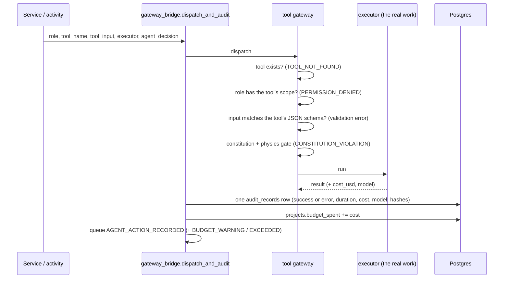

# 4. Agents and the tool gateway

AVOS's "agents" are roles with scoped permissions. They act only by calling **tools** through the **tool gateway**,
so every action is validated, permission-checked, rule-checked, timed, costed, audited and broadcast.

## Roles and scopes (`agentic_core/tool_gateway/permissions.py`)

| Role | Tool scopes | Does |
|---|---|---|
| Director | memory, planning, scheduling, approval | Decides the next step; searches memory; plans shots (`create_shot_spec`, `validate_shot_spec`, `get_world_state`, `submit_video_generation`); approves shots (`approve_shot`) |
| Research agent | research | `research_topic` |
| Narrative agent | script | `generate_script` |
| Audio agent | audio | `generate_audio` |
| Physics agent | blender | `run_blender_proxy` |
| Video agent | comfyui | `generate_video_shot`, `assemble_video` |
| QA agent | qa | `run_qa_committee` |
| Repair agent | repair | `repair_shot` |
| Learning agent | analytics, memory | (reserved for learning from results) |

Registered tools (`tool_gateway/default_registry.py`): `ping`, `search_memory`, `research_topic`, `generate_script`,
`generate_audio`, `create_shot_spec`, `validate_shot_spec`, `get_world_state`, `run_blender_proxy`,
`generate_video_shot`, `run_qa_committee`, `repair_shot`, `approve_shot`, `assemble_video`,
`submit_video_generation`.

## A tool call

- **Validation** (`apps/tool_gateway/validation.py`, `registry.py`, `schemas.py`): each tool declares an input schema;
  calls that don't match are rejected before running.
- **Constitution** (`agentic_core/tool_gateway/constitution.py`): hard rules no agent can bypass.
- **Physics gate** (`api/src/services/physics_gate.py`): pixel-generating tools are refused unless the shot's current
  version has its physics proxy ("physics before pixels").
- **Audit** (`audit_records`, `GET /agents/trace`): exactly one row per call, success or failure.

## The Director (`agentic_core/director`)

- `context_manager.py` assembles a `ProjectSummary` (what exists for the project).
- `director.py` (`StudioDirector`) is a deterministic policy over the pipeline state: research → write script →
  await approval → generate audio → done (or stop on rejection). Content itself (research notes, scripts, shot ideas)
  comes from the project's text model through the tools.
- `memory.py`: searches earlier work on the same topic before researching.
- `agentic_core/runtime`: an agent/graph runtime for multi-step agent reasoning (see `docs/architecture/09_langgraph_agent_reasoning.md`); the production pipeline itself is driven by the Temporal workflow.

## Repair agent (`agentic_core/agents/repair/classifier.py`)

Pure logic: `classify_failure` picks the most responsible QA dimension and the stage a fix targets;
`rung_for_attempt` maps attempt 1 → MICRO, 2 → MACRO, 3+ → HUMAN_REQUIRED; `build_repair_plan` produces a minimal,
scoped change (a nudged seed, or a prompt correction), or nothing once a human is required.

## Agents in the Animations studio

The Animation Studio has its own crew model (see [06-animation-studio.md](06-animation-studio.md)): a director,
builders, and fresh independent reviewers, all calling one `Crew` interface over local or hosted text models. Those
calls are logged to the project's `logs/events.jsonl` and streamed to the page, not to Postgres.
