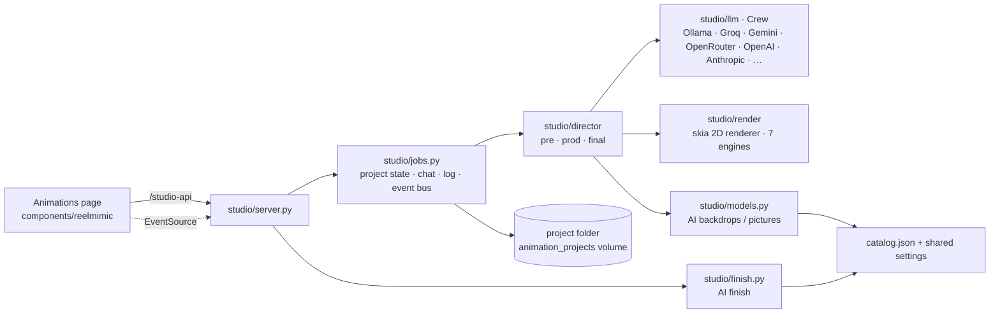
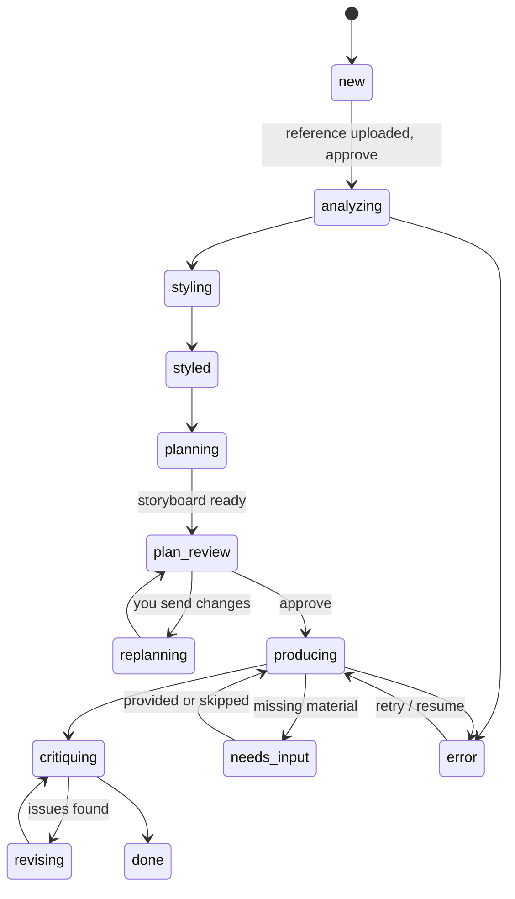

# 6. Animation Studio (the Animations tab)

`apps/animation_studio` is a Python port of ReelMimic's server: you give it a **reference video** (plus an optional
brief, song, lyrics, pictures), and an AI crew studies the reference, plans a storyboard, builds a 2D animation with
its own renderer, reviews it with fresh reviewers, and assembles the final MP4. It runs as its own FastAPI service on
**:8020** and keeps each project as a **folder on disk** (no Postgres). The desktop reaches it through the Next.js
rewrites `/studio-api/*` → `:8020/api/*` and `/studio-files/*` → `:8020/files/*`.



## Project stages



Stages: `new`, `analyzing`, `styling`, `styled`, `planning`, `replanning`, `plan_review`, `producing`, `critiquing`,
`revising`, `needs_input`, `done`, `error`.

## Director phases (`studio/director`)

Every phase is run by `director.run_phase(phase, jid, vars, session, who, abort)`, logs to the project and can be
cancelled.

| File | Phases | What they do |
|---|---|---|
| `pre.py` | `style` | Analyses the reference (shots, pace, camera, palette) → `analysis/report.json` + `STYLE.md`, picks an engine |
| | `plan` | Target duration, format, shot slots (from the reference cuts and the song's BPM), a baseline plan merged with the crew's plan → `plan.json` + `STORYBOARD.md` |
| | `pre_cast`, `pre_assets` | Characters (cast) and props/backdrops to fetch or make |
| | `plan_frames` | Key frames per shot |
| | `replan` | Applies your chat message to the plan (crew, or built-in rules without AI) |
| `prod.py` | `setup` | Splits shots into chunks for the builders (`STUDIO_BUILDERS`) |
| | `cast_qa`, `cast_fix` | Renders cast sheets; independent reviewers (incl. vision) check them; fixes |
| | `build_chunk` | Builders write each shot's spec → rendered with `studio/render` |
| | `shot_qa`, `fix_chunk`, `shared_fix` | Shot sheets reviewed; fixes per chunk or shared across shots |
| `final.py` | `assemble` | Concats shots, narration/TTS, music, lyrics subtitles → `out/video.mp4` |
| | `critique` | Contact sheet + audio level checks + reviewer → `out/check/critique.json` |
| | `revise` | Applies the critique, re-renders, re-assembles |
| `build.py`, `common.py` | — | Shot specs, stills, metrics, timings, palettes, storyboard markdown |

Review rounds are bounded per project (`castRounds`, `chunkRounds`, `finalRounds`; `POST /settings` on the project).

## Renderer (`studio/render`)

skia-python, deterministic, frame-by-frame: `scene`, `shot`, `rig` (characters), `actions`, `props`, `backgrounds`,
`images` (AI or fetched pictures), `text`, `fx`, `pen`, `color`, `engines`.

Seven engines (looks): **hyperframes**, **painted-animation**, **crayon-storybook**, **pixel-art**, **paper-cutout**,
**whiteboard**, **anime-cel**. Assets (fonts, styles, characters) are vendored in `reelmimic_assets/`.

## AI crew (`studio/llm`)

One `Crew` interface over: Ollama (default, local), Groq, Gemini, OpenRouter, OpenAI, Anthropic, Claude Code, Codex,
built-in rules (no AI), and any **text model added in Settings** (OpenAI-compatible). `agent_kinds()` lists what is
available; `/api/agents/settings` picks the crew and models, `/api/agents/pull` downloads an Ollama model.

## Pictures and AI finish

- `studio/models.py`: `image_choices()` for AI backdrops/pictures (catalog models, free chain, your models via
  `run_custom` / `replicate_run`), using the same `catalog.json` and shared settings as Facts.
- `studio/finish.py` — **AI finish**: sends the finished 2D film shot by shot through an open video model
  (`finish_choices()`: Wan VACE, Wan 2.2 Animate, SCAIL-2, LTX-2.3, or your video model) on ComfyUI or fal.ai,
  concatenates the results and keeps the original audio → `out/video_ai.mp4`, status in `out/finish.json`.

## API (`studio/server.py`, prefix `/api`)

| Method | Path | Purpose |
|---|---|---|
| GET | `/health` | Liveness |
| GET | `/agents` · `/agents/info` | Crews available / details |
| POST | `/agents/settings` · `/agents/pull` | Choose crew & models / pull an Ollama model |
| GET | `/config` | Engines, defaults, picture and finish choices |
| GET / POST | `/projects` | List / create (reference, brief, agent, language, settings) |
| GET | `/projects/{id}` | Full snapshot: job, brief, report, style, plan, storyboard, checks, video, critique, cast, shots, production, lyrics, rounds, inputs, engine, finish |
| POST | `/projects/{id}/inputs` | Upload material (reference, song, pictures) |
| POST | `/projects/{id}/message` | Chat to the director (changes the plan) |
| POST | `/projects/{id}/approve` | Approve the current step (409 while inputs are still open) |
| POST | `/projects/{id}/lyrics` | Save lyrics (aligned to the song) |
| POST | `/projects/{id}/waive` · `/unwaive` | Skip / un-skip a requested input |
| POST | `/projects/{id}/resume` · `/accept` · `/retry` · `/critique` | Continue, accept as is, retry after an error, run another critique |
| POST | `/projects/{id}/settings` | Review rounds |
| POST | `/projects/{id}/finish` | Start the AI finish `{model}` |
| POST | `/projects/{id}/cancel` | Stop the current turn |
| GET | `/projects/{id}/events` | SSE: `job` (stage) and `log` events |
| GET | `/files/{id}/{path}` | Any file in the project folder |

Busy guard: actions return 409 while the crew is working on the project.

## Project folder

```
<STUDIO_PROJECTS>/<id>/
├─ job.json              stage, chat, log, needs, waived, settings
├─ brief.md  inputs/     your brief and uploads
├─ analysis/             report.json, STYLE.md, lyrics/subs.json
├─ plan.json  STORYBOARD.md
├─ build/production.json shot specs
├─ out/video.mp4         the animation
├─ out/video_ai.mp4      the AI-finished version  (out/finish.json = status)
├─ out/check/            cast sheets, shot sheets, critique.json
└─ logs/events.jsonl     everything the crew did
```

A server restart marks an interrupted turn ("This turn was cut off by a server restart") so it can be resumed.

## Series (`studio/series`)

A second way to work in the Animations tab: an animated series with your approval at every step (characters one by
one, the outline, each part's script, each rendered part), rendered part by part (1 min, then 3 min…) on your GPU
workers with keyframes drawn from the approved character sheets, cloned voices, lip-sync, sound effects and music.
See [12-series.md](12-series.md).
