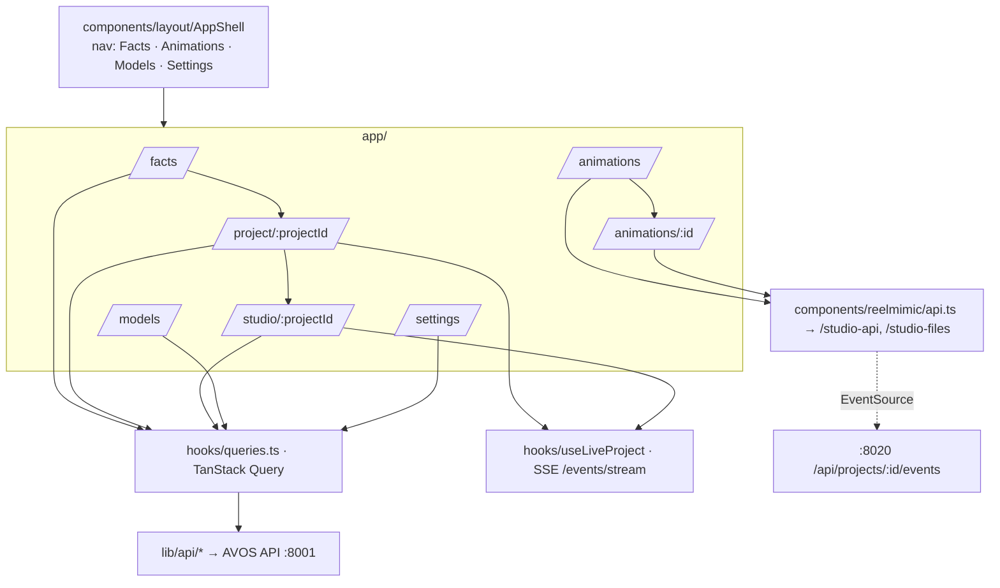

# 7. Frontend (desktop)

`apps/desktop` is a Next.js 16 App Router app (React 19, TypeScript, Tailwind 4, TanStack Query) on **:3000**,
started with `npm run dev`. It talks to the AVOS API directly (`NEXT_PUBLIC_API_URL`, default
`http://<host>:8001/api/v1`) and to the Animation Studio through same-origin rewrites.

## Pages

| Route | What |
|---|---|
| `/` · `/dashboard` | Redirect to `/facts` |
| `/facts` | **FactsComposer** (topic, duration, aspect, style, text / picture / video model incl. your models; defaults `best` / `best`) + project list (`ProjectCard`) |
| `/project/[projectId]` | Pipeline steps, script approval, final video (`FinalVideoCard`), jobs and warnings |
| `/studio/[projectId]` | The Studio: storyboard, timeline, generation monitor, QA dashboard, shot editor |
| `/animations` · `/animations/[id]` | Animation Studio home (reference video → create) and a project (chat, storyboard, checks, video, AI finish) |
| `/models` | Model catalog: readiness, backend, licence, VRAM per precision, what's missing |
| `/gpu` | GPU workers (VRAM, loaded models, queue, backends), generation limits, router preview, runs, learned performance |
| `/settings` | API keys (any name), GPU server (ComfyUI URL, test, "Run models on"), your models, workflow uploads |
| `/login` | Placeholder sign-in |

## Components

| Folder | Components |
|---|---|
| `components/layout` | `AppShell` (sidebar nav), `ThemeToggle` |
| `components/projects` | `FactsComposer`, `ProjectCard`, `PipelineSteps`, `FinalVideoCard`, `StatusBadge`, `ProjectDetailSkeleton` |
| `components/studio` | `StudioShell` (layout; right panel `w-96`), `StudioHeader`, `Storyboard`, `ShotCard`, `Timeline`, `GenerationMonitor`, `QADashboard`, `ScriptApproval`, `ShotInfo`, `ShotEditor` (with the **Edit shot** panel), `DecisionTrace` |
| `components/reelmimic` | `Home`, `Project`, `Chat`, `Shell`, `OpenModels` (AI settings), `ui`, `i18n` (English / Chinese via opencc-js), `api.ts`, `types.ts` — restyled to the AVOS look |
| `components/gpu` | `RunsTable` (GPU page and the Studio's "where it ran" lines) |
| `components/ui` | badge, button, card, input, label, scroll-area |

`AgentChat.tsx` and the physics-proxy panel still exist in the tree but are no longer mounted in the Studio.

### Edit shot panel (`ShotEditor.tsx`)

Fields: description (what we see), camera, environment (place), mood/lighting, and a free **prompt** textarea.
Buttons **Save & regenerate shot** (`POST /shots/{id}/edit`) and **New take** (`{new_take: true}`), then polls
`GET /shots/{id}/regenerate` every 2 s and shows the step (`regen-status`). Test ids: `edit-shot`, `edit-prompt`,
`edit-save`, `edit-take`, `regen-status`.

## Data layer

- `lib/api/core.ts`: base URL and fetch with the error envelope; `projects`, `jobs`, `gates`, `shots` (`edit`,
  `regenStatus`), `qa`, `director`, `assets`, `models`, `settings` clients.
- `hooks/queries.ts`: TanStack Query hooks and keys per resource.
- `hooks/queries.ts` also has `useGpu` (3 s refresh) and `useGpuJobs(projectId)`; `GPU_JOB_*` events invalidate them.
- `hooks/useLiveProject.ts`: opens `EventSource` on `/events/stream?project_id=` and invalidates the right queries
  per event type (gates, shots, jobs, QA, budget).
- `types/*`: `project.ts` (provider lists; the blender entry is `hidden: true`), `shot.ts` (`ShotEdit`,
  `RegenStatus`), `models.ts`, etc.
- `next.config`: rewrites `/studio-api/:path*` → `${ANIMATION_STUDIO_URL}/api/:path*` and `/studio-files/:path*` →
  `/files/:path*` (default `http://127.0.0.1:8020`).
