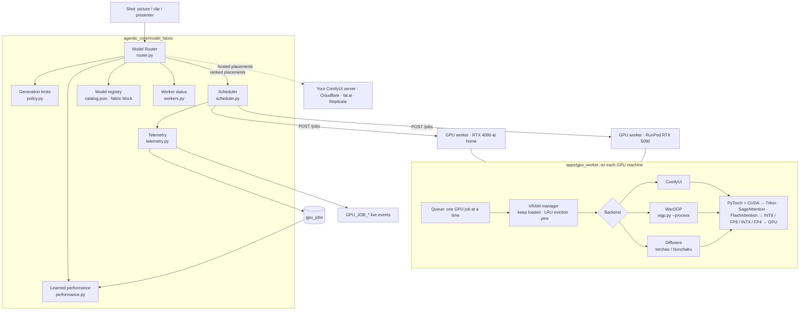

# 10. Model Fabric and GPU workers

AVOS decides **what** should happen: which model, at what quality, and within which limits. **GPU workers** decide
**how** to run it: on ComfyUI, Wan2GP or Diffusers, at a precision and with an attention kernel their GPU supports.
Adding a model is a catalog entry, or Settings → Models. Adding a GPU is one address on the GPU page. Nothing else
changes.



## The Model Router (`router.py`)

The router doesn't ask "what is the best model?". It scores every way the job could run:

1. **Candidates.** Models for the task: image, video or avatar. These come from the catalog plus your own models,
   or only the model a project picked.
2. **Places to run.** Each online GPU worker × backend × precision that fits its VRAM. Also your ComfyUI server,
   Cloudflare, fal.ai and Replicate.
3. **Hard checks.** Each check below rules a place out; ruled-out places are listed with the reason.
   - VRAM: enough to run, or CPU offload when the model's minimum fits.
   - Precision: native on that GPU (bf16 on RTX 30+, fp8 on RTX 40 / L40S / H100, fp4 on RTX 50 / B200).
   - The backend has the model installed.
   - The limits allow the estimated cost and time.
4. **Estimates.**
   - **Quality:** the model's base quality, then:
     - adjusted for this shot: readable text, narration-driven, long shot, continuity, multi-speaker;
     - lowered for precision (bf16 1.0 → int4 0.955);
     - corrected by the measured QA of past runs, and by their failure rate.
   - **Time:**
     - GPU time = catalog speed × GPU speed (relative to an RTX 4090) × precision factor × attention factor (sage2 ≈ 0.71);
     - plus model load, unless the model is already loaded;
     - plus queue wait. Measured speed replaces the estimate after 3 runs.
   - **Cost:** the worker's $/hour × GPU time, or the hosted price.
5. **Score** by the preference:

| Preference | Quality · speed · cost weights |
|---|---|
| quality | 0.70 · 0.15 · 0.15 |
| balanced (default) | 0.50 · 0.25 · 0.25 |
| speed | 0.30 · 0.55 · 0.15 |
| cost | 0.30 · 0.15 · 0.55 |

A preferred model gets +0.25 and a fallback model +0.05. The result is ranked placements, each with its reasons,
plus the rejected ones and why they were rejected.

The catalog providers (`CatalogImageProvider`, `CatalogVideoProvider`, and the `best` choices) ask the router per
call. They try the placements in order: if a run fails on one GPU, the next placement (another GPU, ComfyUI or fal.ai)
is tried, and each attempt is recorded.

### Routing data in the catalog (`catalog.json`, `fabric` block per model)

| Field | Example (Wan 2.2) | Used for |
|---|---|---|
| `quality` | 0.90 | base quality |
| `vram_gb` | bf16 28 · fp8 16 · int8 16 · int4 9 | which precision fits which GPU |
| `min_vram_gb` | 8 | CPU offload threshold |
| `speed` | 120 | GPU seconds per output second on an RTX 4090 at bf16 |
| `load_seconds` | 90 | cold start |
| `strengths` | general, i2v | shot fit (text, audio, long, continuity, presenter…) |
| `adapters` | comfyui, wan2gp, diffusers | backends that can run it |
| `fal_usd_per_second` / `fal_usd`, `hosted_seconds` | 0.08, 90 | hosted cost and time |

## Generation limits (`policy.py`)

The defaults are set on the GPU page (`PUT /gpu/limits`). A project can override them, either as Priority in
New video or with `PUT /gpu/projects/{id}/limits`, stored in `projects.generation_policy`.

| Limit | Default | Effect |
|---|---|---|
| `preference` | balanced | the scoring weights above |
| `max_cost_per_shot` | none | placements estimated above it are rejected |
| `max_seconds_per_shot` | none | placements estimated slower are rejected |
| `max_attempts` | 3 | generations per shot including the first; the repair ladder goes to HUMAN_REQUIRED past it |
| `allow_hosted` | true | paid hosted APIs allowed |
| `preferred_model` / `fallback_model` | none | scoring bonus |
| `quality_threshold` | 0.6 | stored for learned routing (phase 4) |

While a shot is generated, `VideoGenerationService.generate` runs inside `fabric_service.shot_context(project,
shot, version)`. That applies the project's limits and installs the telemetry sink.

## GPU workers (`apps/gpu_worker`)

A small FastAPI service on each GPU machine, port 8700, one per GPU:

| Endpoint | Purpose |
|---|---|
| `GET /health` | liveness (no token) |
| `GET /status` | GPU (name, VRAM total/free, temperature, utilisation, compute capability, driver, CUDA), supported precisions and installed kernels (triton, sageattention, flash_attn, nunchaku, torchao), each backend's readiness / models / precisions / best attention, loaded models, queue, average job time, $/hour |
| `POST /jobs` | queue a job: model, adapter, precision, attention, offload, VRAM need, prompt, size, seconds, frames, fps, seed, base64 inputs (image / audio / video) |
| `GET /jobs/{id}` · `/result` · `DELETE` | progress, output file, cancel / forget |
| `POST /models/load` · `/models/unload` | warm a model before a batch / free its VRAM |
| `PUT /workflows/{model}` | AVOS sends the ComfyUI workflows uploaded in Settings |

- **Queue.** One GPU job at a time: `queued → loading → running → done | error | cancelled`.
- **VRAM manager** (`vram.py`).
  - Keeps models loaded between shots.
  - When a new model doesn't fit, evicts the least recently used one. Models in `WORKER_PIN` are never evicted.
  - Uses each job's VRAM need from the catalog and the free VRAM reported by `nvidia-smi`, so it respects other
    programs on the GPU.
- **Backends** (`adapters/`):
  - **comfyui**: one API-format workflow per model. `{{WEIGHT_DTYPE}}` applies the precision; progress comes over
    the websocket.
  - **wan2gp**: headless `wgp.py --process <settings>` with `--attention` and `--quantize-transformer`. The model
    loads on every job.
  - **diffusers**: in-process pipelines with torchao / Nunchaku quantization, an attention backend and CPU offload.
  - **mock**: no GPU; produces coloured stand-ins (`WORKER_MOCK=1`).
- **Security.** A shared bearer token, `GPU_WORKER_TOKEN`, is set in AVOS (Settings → API keys) and on every worker.

Install: `pip install -r requirements.txt && python -m worker`, or `docker compose -f docker-compose.gpu.yml up -d`
(NVIDIA Container Toolkit). See `apps/gpu_worker/README.md` for RunPod / Vast.ai and several GPUs in one machine.

## Telemetry and learning

- Every run, wherever it ran, is wrapped in `telemetry.track(placement, task, units)`. That emits queued, started,
  progress (every ~3 s), completed or failed.
- The API sink writes one **`gpu_jobs`** row per run in its own short transaction, so the GPU page sees it at once.
  It then publishes **`GPU_JOB_QUEUED/STARTED/PROGRESS/COMPLETED/FAILED`**.
- Each row records: the placement (model, backend, worker, GPU, adapter, precision, attention, offload, warm), the
  estimate (seconds, cost, score, reasons) and the result (GPU seconds, wall seconds, cost, error).
- **QA** writes its score onto the shot version's completed runs (`record_qa`).
- **`load_performance()`** aggregates per (model, GPU or backend): runs, successes, GPU seconds per unit and
  average QA. The router reads this through `performance.refresh()`.

## Shot order on a GPU

The generation service makes all of a shot's pictures first, then its clip. A worker therefore loads the picture
model once and the video model once per shot, instead of swapping them in and out of VRAM between candidates.

## Animations

`animation_studio/studio/gpu.py` gives AI backdrops and the AI finish the same workers, through a compact version of
the router:

- it uses the same catalog VRAM table and the same worker reports;
- it prefers a worker that already has the model loaded, then shorter queue, no offload, lower cost and higher
  precision.

`models.backend_for` tries backends in this order: `gpu` → `comfyui` → `cloudflare` → `fal`. `MODEL_BACKEND=gpu`
forces workers.

## API (`/api/v1/gpu`)

| Method | Path | Purpose |
|---|---|---|
| GET | `/gpu` | workers (live), limits, totals, recent runs, backend mode, token set |
| GET / POST / DELETE | `/gpu/workers` · `/gpu/workers/{id}` | list (`?force=true`), add / update, remove |
| POST | `/gpu/workers/{id}/test` · `/load` · `/unload` · `/workflows` | check now, warm, free, push workflows |
| GET | `/gpu/jobs?project_id=&limit=` | runs |
| GET | `/gpu/performance` | learned stats |
| PUT | `/gpu/limits` | default limits |
| POST | `/gpu/route` | router preview (nothing is generated) |
| PUT | `/gpu/projects/{id}/limits` | a project's limits |

## UI

- **GPU page** (`/gpu`):
  - totals;
  - a worker card per GPU: VRAM bar split by loaded models, temperature, utilisation, precisions, backends,
    loaded models (with unload), running job and queue, and the buttons Test, Send workflows, Turn off and Remove;
  - an add-worker form;
  - generation limits;
  - **Ask the router**;
  - the runs table, live;
  - what routing has learned.
- **New video**: a Priority chip, which sets the project's preference.
- **Studio**: each shot shows where its clip and pictures ran, for example "Clip: ltx-2.3 · RTX 4090 · int4 · 46 s ·
  free".
- **Models page**:
  - "Your GPU workers" appears as a backend;
  - each model card lists its VRAM need per precision.
- **Settings**: "Run models on: Only my GPU workers".

## Code map

```
agentic_core/model_fabric/   router · workers · scheduler · policy · performance · telemetry · requirements
agentic_core/models/         catalog.py (gpu backend), image/catalog_image.py, video/catalog_video.py (use the router)
apps/gpu_worker/             worker/{app,jobs,vram,gpu,config}.py, adapters/{comfyui,wan2gp,diffusers_adapter,mock}.py
api/src/services/fabric_service.py   sink → gpu_jobs + events, performance loader, QA feedback, shot_context
api/src/routes/gpu.py        /api/v1/gpu
api/alembic/versions/13_model_fabric.py   gpu_jobs + projects.generation_policy
animation_studio/studio/gpu.py   workers for AI backdrops and the AI finish
desktop/app/gpu/page.tsx, components/gpu/RunsTable.tsx, lib/api/gpu.ts, types/gpu.ts
```
