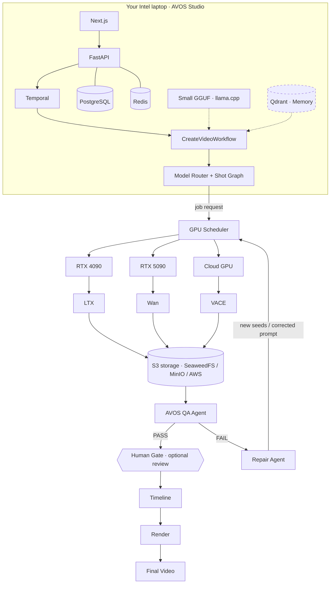

# 11. GPU Scheduler, the QA loop, storage and model downloads

This is the production layout: AVOS Studio runs on your laptop, and the GPUs do the generating.

The dashed Qdrant / Memory box comes in the planned memory phase, together with LangGraph-based agent memory. All
the other boxes are built.

## GPU Scheduler

The scheduler is split across both sides of the network:

- **AVOS side:** `agentic_core/model_fabric/dispatch.py` and `scheduler.py`.
- **GPU side:** each worker's own queue.

| Part | What it does |
|---|---|
| **Parallel shots** | The workflow generates several shots at once (`VISUAL_CONCURRENCY`, "auto" = 2 per online GPU, 2–8; 4 with hosted APIs). It uses `workflow.patched("parallel-visuals-v12")`, so older running workflows replay unchanged. |
| **Parallel pictures, early clip** | Within a shot, the 3 candidate pictures generate concurrently (`IMAGE_CANDIDATE_CONCURRENCY`). The clip starts as soon as picture 0 is ready. Bytes are generated first, then stored in order on the shot's session. |
| **In-flight ledger** | Every job sent to a GPU is recorded until it finishes. The router adds that work to the GPU's wait, so the next job goes to a free GPU. A model already on its way to a GPU counts as warm there. |
| **Warm-up** | When shots are planned, while physics runs, the project's picture model and video model are loaded with `POST /models/load`. If another GPU is nearly as good, the second model goes there. With two GPUs, pictures and clips each get their own GPU and never swap models in VRAM. |
| **Priorities** | 0 = urgent (a Studio edit someone is waiting for), 5 = production, 9 = background. Workers run the most urgent queued job first. The router ignores less urgent work when it estimates an urgent job's wait. |
| **Queue on the GPU page** | Each worker card lists its queue in run order: model, task, *urgent* badge, and which project and shot it is for. |
| **Animations** | The AI finish runs shots in parallel (`FINISH_CONCURRENCY`, auto = 2 per online GPU, 3 on fal.ai). `studio/gpu.py` counts its own in-flight jobs per worker. |

In a test run (6 shots, two pretend GPUs), pictures went to the RTX 4090 and clips to the RTX 5090, each model
already loaded for every job. The run went from script approval to the review gate in 84 s.

## Other speed-ups

- **Final render.** Shot segments are prepared side by side (`RENDER_PARALLEL`, half the CPU cores, max 4) and then
  joined.
- **Text-model answer cache** (`models/llm/cache.py`). The same request within `LLM_CACHE_TTL` (default 1 h) returns
  at once, so Temporal retries cost nothing. The provider class is unchanged.
- **Faster polling.** Pictures are polled every 0.5 s; jobs deep in a queue are polled less often.
- **Concurrency-safe storage.** The Asset Registry uses a savepoint on its unique content hash. The presenter
  portrait is made once per project, with a lock and cache shared across parallel shots.

## QA → repair loop and the review gate (`api/src/temporal/activities/qa.py`)

After the visuals, with `workflow.patched("qa-repair-v12")`:

1. **QA agent** (`run_qa_committee` through the tool gateway) checks each shot, several in parallel.
2. **FAIL → Repair agent** (`repair_shot`): MICRO uses new seeds and MACRO a corrected prompt, both regenerating on
   the GPUs. Then QA runs again. This repeats up to the **max generations per shot** limit, after which the shot is
   marked `NEEDS_REVIEW` and its last version is used, with a warning on the project.
3. If **review shots** is on (New video → "Review shots first", or the GPU page limits), a `final_approval` gate
   opens and the project status becomes `awaiting_review`. The Studio shows **Review the shots**: each shot's QA
   result, click to edit it, then **Render the final video** or **Stop here**. Approving continues to the render.

QA's visual check now judges real pictures. It decodes PNG, JPEG or WebP with Pillow and fails a frame that:

- has the wrong aspect ratio for the project;
- is under 256 px on its short side;
- is blank or a single colour (brightness spread below 3).

The mock 64×36 placeholder still passes. The limits gained two switches: `auto_qa` (default on) and `review_shots`
(default off).

## S3-compatible storage (`api/src/core/assets/storage.py`, `s3.py`)

- **Turning it on.** Set `ASSETS_STORAGE=s3` to store assets in S3-compatible storage. The Compose file includes an
  optional `object-store` service (SeaweedFS, Apache-2.0, S3 API on :8333): start it with
  `docker compose --profile storage up -d`. MinIO's images were removed from Docker Hub in September 2026, so it is
  no longer bundled, but any MinIO, AWS S3 or R2 endpoint works through `S3_ENDPOINT`.
- **How it is stored.** S3 is the store of record and `/data/assets` is a write-through cache. Rows store
  `s3://bucket/xx/<sha256>.<ext>`, and older local rows still read.
- **The client.** A small AWS SigV4 client over httpx, no boto3. Tests check its signatures are byte-for-byte equal
  to botocore's and round-trip assets through an S3 server (moto).
- **Settings.** `S3_ENDPOINT`, `S3_BUCKET`, `S3_ACCESS_KEY`, `S3_SECRET_KEY`, `S3_REGION`. This works with SeaweedFS (tested), MinIO,
  AWS, Cloudflare R2 and Backblaze B2.

## Model downloads (Models page → Download)

- **File lists.** `agentic_core/models/downloads.json` holds the exact ComfyUI files per model and precision (repo,
  path, ComfyUI folder, size in bytes). They were checked against Hugging Face's file listings and ComfyUI's official
  templates. `model_fabric/model_files.py` holds the options, the recommended version for your largest GPU, and
  "already here?" checks.
- **Downloader.** `model_fabric/downloads.py`; the GPU worker has an identical copy.
  - Downloads stream to `<folder>/<diffusion_models|text_encoders|vae|loras|…>/<file>.part`, then rename.
  - Interrupted downloads resume with HTTP Range. Complete files are skipped.
  - Free disk space is checked first, and 2 files download at a time.
  - Errors are explained: a gated repo needs `HF_TOKEN`, a file may be missing or incomplete.
- **Where files go:**
  - **This PC:** `AVOS_MODELS_DIR`; in Docker that is `/models`, mounted from `AVOS_MODELS_HOST_DIR` in `apps/.env`
    (default `apps/models`). `DOWNLOAD_ROOTS` limits the folder picker.
  - **A GPU worker:** its `WORKER_MODELS_DIR` (or `COMFYUI_DIR/models`), straight where ComfyUI loads them.
- **API.** `GET /downloads/models/{id}?where=&path=`, `GET /downloads/browse`, `POST /downloads/mkdir`,
  `POST /downloads`, `GET /downloads` (this PC + every worker), `DELETE /downloads/{where}/{id}`.
- **UI.** The panel offers Where (This PC, or each GPU worker) and Version, with sizes and "Recommended for your GPU".
  It also has Extras, Folder (browse, up, new folder, free space) and the size to download. A Downloads list shows
  progress, speed and ETA, with cancel; start again to resume.

## llama.cpp (small GGUF on the laptop)

A new text model choice, **llama.cpp**: llama.cpp's `llama-server` exposes the OpenAI API.

- **Facts:** `LLAMACPP_URL` (default `http://host.docker.internal:8080`) and `LLAMACPP_MODEL`.
- **Animations:** a **llama.cpp (local GGUF)** crew, ready when its server answers `/v1/models`.
