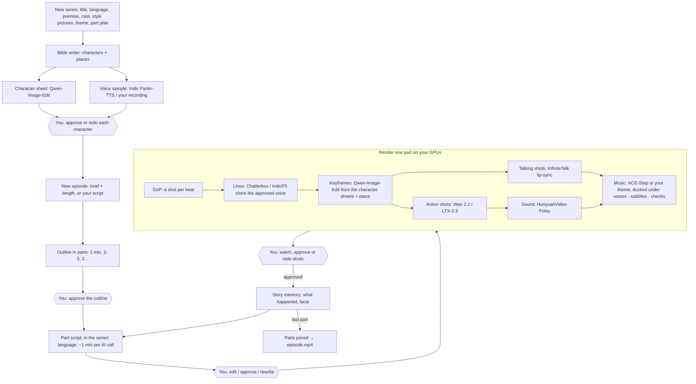

# 12. Series: characters you approve, episodes in parts

Animations → **Series** makes an animated series with a person approving every step. It lives in the Animation
Studio (`apps/animation_studio/studio/series/`) and runs every model on your GPU workers.



## The gates

| Gate | What you see | What you can do |
|---|---|---|
| Characters | Sheet (front / side / ¾ + 3 expressions), voice sample with its line, which model made each | Approve · redo look or voice with a note · edit the description · upload your own drawing or voice recording · add / remove characters |
| Outline | Each part's summary and how it ends | Approve · outline again with a note |
| Part script | Every beat: speaker, emotion, line; actions with their sounds | Edit any line, emotion, action, remove beats · approve and render · rewrite with a note |
| Rendered part | The part (video + subtitles), every shot with its keyframe, the models used, warnings and fallbacks | Approve (the next part is written) · select shots and redo their picture / motion / voice with a note |

Only approved characters can speak. One episode is in production at a time, so the story memory stays in order.

## Parts

`partPlan` (default `1,3`) sets the lengths: the first number is the first part, the last repeats. A 10-minute
episode becomes 1, 3, 3, 3; 11 minutes becomes 1, 3, 3, 4 (a short remainder joins the last part). A short first
part checks the direction before the long parts spend GPU time.

## Models per step, and fallbacks

| Step | Open model (GPU worker backend) | Fallback |
|---|---|---|
| Character sheets, places, keyframes | Qwen-Image-Edit 2511 (ComfyUI or Diffusers), up to 3 reference pictures: the shot's character sheets and the place | Text-to-image (Qwen-Image / Z-Image): marked "looks may drift" |
| Voice design | Indic Parler-TTS (speech backend) from the voice description | An Edge voice per character (distinct voice + pitch offset) |
| Lines | Chatterbox (23 languages) or IndicF5 (11 Indian languages), cloned from the approved sample, emotion → exaggeration | Indic Parler-TTS from the description, then the character's Edge voice |
| Talking shots | InfiniteTalk (lip-sync to the line), LongCat Avatar | The keyframe with a slow push-in |
| Action shots | Wan 2.2 I2V (≤ 5 s), LTX-2.3 (longer) | The keyframe with a camera move |
| Sound effects | HunyuanVideo-Foley (foley backend) on the clip | None |
| Music | Your theme track, else ACE-Step 1.5 (ComfyUI) | None |

The Series page's **Models** panel shows which one each step will use right now. Each shot records the model
behind its voice, picture, motion and sound, and the part review lists any fallbacks.

## Writers' room (`writers.py`)

The series' AI crew (the same crews as Animations: Groq, Ollama, Gemini, llama.cpp…) in six roles: bible, outline,
part script, script import, DoP, continuity. Answers are repaired before use: unknown speakers are dropped, bad
emotions become neutral, lengths are clamped, ids are added. With an AI crew, an unusable answer is an error you
see, never a placeholder; the built-in crew (no AI) writes simple drafts so the flow can be tried offline.

- Dialogue is written in the series' language and script; actions, pictures and sounds are in English for the models.
- A part is written about a minute per AI call, each call continuing from the last beats.
- On Groq, `max_tokens` is kept within the free tier's per-minute budget, rate limits are waited out (15 / 30 / 60 s),
  and gpt-oss runs with `reasoning_effort=low` (`STUDIO_REASONING_EFFORT`).
- Your own script: lines as `Name: (emotion) text`, anything else an action, `INT./EXT./SCENE` starts a scene. The AI
  maps it to the structure without changing a word; without AI a rule-based parser does it. Then it is cut into parts
  by length.

## Rendering a part (`pipeline.py`)

Steps run one after another, with the shots of each step spread over your GPU workers (`SERIES_CONCURRENCY`, auto =
2 per online worker). One model is used per step at a time, so it stays loaded on each GPU instead of swapping.

1. Voices (also fix each dialogue shot's length: the line + 0.35 s).
2. Missing place pictures, then keyframes.
3. Motion: lip-sync for talking shots, image-to-video for action shots.
4. Sound effects for action shots.
5. Each shot fitted to its length at 24 fps; its audio is the line plus sound effects. Checks run: a blank picture, a
   silent line, any fallback.
6. Music for the part (looped, faded, side-chain ducked under the voices), mix, subtitles (soft track + `.srt`).

Every file is cached per shot with a fingerprint of what made it (text, voice version, sheet versions, takes, note).
A redo bumps the take of the chosen shots (picture, motion and/or voice), so only those are made again. A resume
after a stop, an error or a restart only makes what is missing.

## Files and API

```
/data/series/<id>/series.json               characters, places, story memory, episode index, work state
/data/series/<id>/characters/<cid>/         sheet_v<n>.png, voice_v<n>.wav, uploads
/data/series/<id>/episodes/<eid>/episode.json, parts/<n>/shots/<shot>/{line.wav,key.png,clip.mp4,sfx.wav,fit.mp4,shot.wav}
/data/series/<id>/episodes/<eid>/parts/<n>/part.mp4 (+ .srt), episode.mp4 (+ .srt)
```

The API is `/api/series/...` on the studio (see `routes.py`'s docstring); the desktop reaches it through
`/studio-api/series/...`. Pages: `app/animations/series/page.tsx` (list + new series) and
`app/animations/series/[id]/page.tsx` (`components/series/*`).

## GPU worker additions

- `speech` backend (`worker/adapters/speech.py`, `requirements-speech.txt`): chatterbox, indicf5, indic-parler-tts.
- `foley` backend (`worker/adapters/foley.py`): HunyuanVideo-Foley's `infer.py`, weights from the Models page.
- ComfyUI: `{{IMAGE2}}`–`{{IMAGE4}}` reference pictures, `{{LYRICS}}` / `{{LANGUAGE}}`, audio results (Save Audio).
- Diffusers: `qwen-image-edit` (`QwenImageEditPlusPipeline`, several reference pictures).
- Jobs carry `options` (speech language, voice transcript or description, emotion; music lyrics) and can return audio.
- The mock backend speaks (tones as long as real speech), makes sound and music, and animates the given picture.

## Tests

`animation_studio/tests/test_series.py` runs the whole flow through the HTTP API against a real GPU worker process
with the mock backend: characters (sheet + voice, a voice redo), the approval gates, an edited line, a part rendered
with every model, a one-shot redo (only that shot is redrawn), part 2, the joined episode, your own script, and the
writers' room through a stand-in Ollama (including broken replies). `gpu_worker/tests/test_series_backends.py` covers
the speech and foley backends, ComfyUI references and audio. `desktop/tests/e2e/series.spec.ts` drives it in the
browser (needs `E2E_GPU_WORKER_URL`).

## Limits

- Not yet tested on real GPUs or real model weights here; the mock backend stands in for every model.
- Lip-sync quality on stylised 2D faces depends on InfiniteTalk; very flat cartoon mouths may move less.
- Keyframe consistency depends on Qwen-Image-Edit following the sheets; a character redrawn wrong can be redone
  per shot. Character LoRAs (training one per approved character) would make faces steadier and are a natural next step.
- Chatterbox's audio carries Resemble AI's inaudible watermark.
