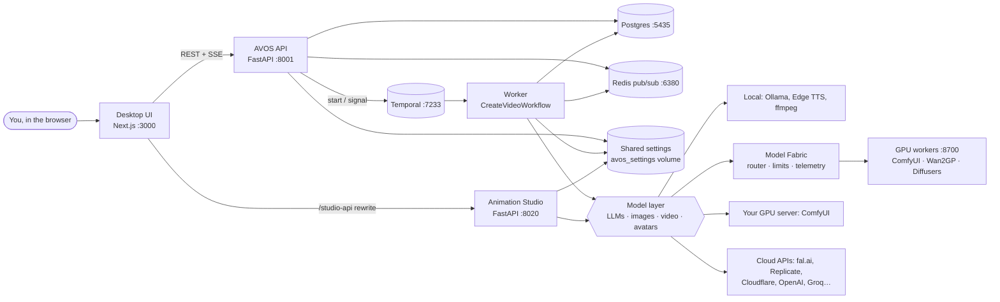

# AVOS architecture

AVOS (AI Video Operating System) turns a topic or a reference video into a finished, narrated video. It has two
studios that share one model layer and one settings store:

| Studio | Input | Output | Engine |
|---|---|---|---|
| **Facts** | a topic ("Why the moon changes shape") | a narrated, captioned short with AI pictures and clips | FastAPI API + Temporal workflow + agent tool gateway |
| **Animations** | a reference video you like + a brief | a new animation in the same style | Animation Studio service (ReelMimic's workflow, rebuilt in Python) |

## Documents

| File | What it covers |
|---|---|
| [01-system-overview.md](01-system-overview.md) | Services, containers, ports, tech stack, repository layout, request flow |
| [02-facts-pipeline.md](02-facts-pipeline.md) | The Facts production pipeline end to end: workflow stages, human gate, shots, world state, QA, repair, final render, editing a shot |
| [03-backend-api.md](03-backend-api.md) | API layers, every endpoint, database schema, asset registry, events and live updates |
| [04-agents-and-tool-gateway.md](04-agents-and-tool-gateway.md) | The Director, agent roles, the tool gateway, permissions, auditing and budget |
| [05-models-and-providers.md](05-models-and-providers.md) | Text, image, video and avatar providers, the model catalog, "best" routing, GPU / fal.ai backends, models you add yourself |
| [06-animation-studio.md](06-animation-studio.md) | The Animations studio: ReelMimic's stage machine, AI crews, the 2D renderer, review gates, AI finish |
| [07-frontend.md](07-frontend.md) | The desktop UI: pages, components, data fetching, live updates |
| [08-configuration-and-deployment.md](08-configuration-and-deployment.md) | Docker Compose, volumes, environment variables, the Settings page, GPU setup, running without Docker |
| [09-testing.md](09-testing.md) | Test suites and how to run them |
| [12-series.md](12-series.md) | Animations → Series: characters approved one by one (sheet + voice), episodes outlined and rendered in parts with an approval at each step, the models per step, the writers' room, caching and redo |
| [11-scheduler-qa-storage-downloads.md](11-scheduler-qa-storage-downloads.md) | The full laptop → GPU scheduler → GPUs → S3 storage → QA → repair / human gate → render picture; parallel shots, warm-up, priorities, speed-ups, model downloads, llama.cpp |
| [10-model-fabric-and-gpu-workers.md](10-model-fabric-and-gpu-workers.md) | The Model Router, generation limits, GPU workers (VRAM, precision, warm models), telemetry and learned performance, the GPU page |

## Design principles

1. **Local and free first, paid as an option.** Every stage has a free path (Ollama, Edge TTS, free picture
   services, ffmpeg camera moves, the built-in 2D engine). Your own GPU server is used before paid APIs; paid APIs are
   used only when you add a key, and fall back to the free path when they fail.
2. **Durable and resumable.** The Facts pipeline is a Temporal workflow: a worker restart, a long human review or a
   failing provider never loses work. Animations projects are folders on disk with a stage machine that resumes.
3. **Humans approve before money is spent.** The script is approved before any audio, pictures or clips are made;
   in Animations the plan is approved before rendering.
4. **Every agent action is audited.** Agents call tools only through the tool gateway, which checks permissions,
   validates inputs, records an audit row (cost, duration, model, hashes) and publishes a live event.
5. **Physics and continuity before pixels.** Each shot is a versioned ShotSpec checked against a WorldState before
   any picture is generated; a shot's QA failure goes through a bounded repair ladder.
6. **AVOS decides what, GPU workers decide how.** The Model Router picks model, GPU and precision per shot from
   quality, speed, cost and VRAM; workers (ComfyUI, Wan2GP, Diffusers) are replaceable execution backends.
7. **One model layer, one settings store.** Both studios read the same model catalog and the same settings file, so a
   key or a model added once works everywhere.
