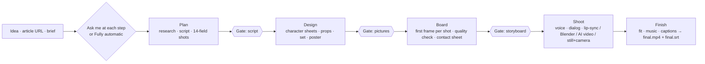

# 13. Explainer Studio (Animations → Explainer)

`apps/animation_studio/studio/explainer/`. One idea, an article link or a written brief becomes a finished, captioned
video with voice, music and lip-sync. It runs in the Animation Studio service (:8020); a project is a folder on disk;
one background thread runs each project. The desktop reaches it through `/studio-api/explainer/...`.

Stages: `plan → design → board → shoot → finish`. Gates at plan, design and board when `auto` is false; Continue skips
finished work after an error or restart.

## Autopilot (agent mode)
At the start the person chooses **Ask me at each step** (three approvals) or **Fully automatic**. Redraws, approvals and
ratings are fed to the prompt library (below).

## Skills (`skills.py`, `skills.json`)
Eleven skills, each with its prompt keys, readiness check and success counts: research, script, characters,
backgrounds, storyboard, voice, dialog, motion, lipsync, music, finish. Optional ones (research, dialog, lipsync,
music) can be switched off. The Skills page (`/explainer/skills`) shows readiness and has **Improve now**.

## Film language (`cinema.py`, `master.py`, `spec.py`)
Every shot has 14 fields: description, speaker, objective, performance, angle, composition, lens, camera move, size,
end state, continuity, and more. Eight angles and ten compositions have fixed phrases; `missing()` lists gaps.
`master.py` builds one timed multi-shot prompt ("master prompt") of the approved plan for Seedance, Kling or Veo.

## Shot router (`router.py`)
forced choice → lip-sync (speaker and lip-sync ready) → Blender (cutaway or physics) → AI video → Blender fallback →
a picture with a camera move. A pinned model (`media.strict`) is never swapped; `local_only` keeps everything on the
machine; motion "off" is allowed.

## Model rules
Automatic = first ready model, then fall down the list. Pinned = only that model; stops with the reason. Local only =
no cloud. Failures: video → picture with camera move; lip-sync → normal video with a warning; voice → silent shot with
captions; music → no music; research unreachable → skipped with the reason; script AI unavailable → built-in outline.

## API (`/api/explainer`)
Prompts: `GET /prompts`, `PUT /prompts/{key}`, `POST /prompts/{key}/restore|reset|improve`, `POST /prompts/learn`.
Skills: `GET /skills`, `PUT /skills/{sid}`, `POST /skills/{sid}/improve`.
Setup: `GET /capabilities`, `/voices`, `/voices/preview`, `/styles`, `POST /article/preview`, `POST /estimate`.
Projects: `GET|POST /`, `GET|PATCH|DELETE /{pid}`, `POST /{pid}/approve`, `GET /{pid}/master-prompt`,
`POST /{pid}/assets/redo`, `/redo-plan`, `/direct`, `/continue`, `/cancel`, `/shots/{sid}`, `/shots/{sid}/rate`,
`GET /{pid}/files/{path}`. (Skills routes are declared before `/{pid}` so they are not shadowed.)

## Desktop
`app/explainer/page.tsx`, `app/explainer/[id]`, `app/explainer/skills/page.tsx`; components `Composer`, `ProjectView`,
`ShotCard`; client `lib/explainer.ts`.

## Tests
`animation_studio/tests/test_explainer.py` (30) and `test_prompts.py` (11), run with stand-in models. The screens have
Playwright specs (`tests/e2e/explainer.spec.ts`) not yet run live from this build.

## Limits
The studio container needs internet for pictures and research; no real end-to-end video yet on the laptop. Pictures are
checked for brightness and duplicates, not scored for likeness. See [15](15-prompt-library.md) for learning.
