# 14. Stickman Studio

`apps/animation_studio/studio/stickman/`. A historical event in, a six-clip stickman video (6 × 10 s) and its full
written production package out. Follows the "Historical Stickman Video Instructions" sheet. Prompts are composed by
code (`prompts.py`) so identity paragraphs are repeated verbatim; the AI supplies creative content as structured data.
The Markdown skill `skills/avos-stickman-director/SKILL.md` sets the writer rules: accuracy, no invented quotes,
motives or casualty figures, narration not invented dialogue, respectful non-graphic tone, no anachronisms.

```mermaid
flowchart LR
  t[Topics: 8 ideas] --> g1{{You pick}} --> b[Fact brief + sources to check] --> s[Story + narration by clip]
  s --> r[Roster: 1–3 characters] --> c[Clip plans + prompts] --> refs[Reference sheets]
  refs --> g2{{You approve}} --> sc[Scene images] --> an[Animation: AI video, else picture + camera move]
  an --> v[Voice] --> f[Captions + final.mp4]
```

Stages: `topics, brief, story, roster, clips, refs, scenes, animate, voice, finish`. Gates: `topics` and `refs` (skipped
with `auto=True`). One background thread per project; Continue skips finished steps.

## Modules
| File | Role |
|---|---|
| `spec.py` | Contracts: topics, fact brief, story, roster, clips; `CLIP_SECONDS=10`; beats hook 0–2 s, main 2–5, reaction 5–8, outcome 8–10; 18–24 narration words per clip; aspects 9:16, 16:9, 1:1; camera moves |
| `planner.py` | The AI's creative stages as small structured calls (Groq-friendly) |
| `prompts.py` | Style lock, negatives, character reference-sheet, scene-image and animation prompts |
| `continuity.py` | Continuity record per clip and checks that need no AI (matched transitions keep people, place, props) |
| `package.py` | The written package as one Markdown file (fact brief, story, roster, prompts, assembly guide, checklist) |
| `store.py` | Project folder: `project.json`, `CHAR_01_sheet.png`, `C01_scene.png`, `C01_video.mp4`, `C01_voice.wav`, `final.mp4`, `final.srt`, `package.md` |
| `pipeline.py`, `routes.py` | The line and the REST API |

Facts are never invented by the app: the brief marks what is well-established or "check", names kinds of sources to
check, and its verification status stays PENDING.

## API (`/api/stickman`)
`GET|POST /`, `GET|PATCH|DELETE /{id}`, `POST /{id}/pick`, `/more-topics`, `/approve`, `/continue`, `/cancel`,
`/clips/{n}` (`scene` or `video`, with a note), `GET /{id}/package`, `GET /{id}/files/{path}`.

## Desktop
`app/stickman/page.tsx`, `app/stickman/[id]/page.tsx`, `components/stickman/{Composer,ProjectView}.tsx`,
`lib/stickman.ts`, e2e `tests/e2e/stickman.spec.ts`. Backend test: `tests/test_stickman.py`. It reuses the Explainer's
captions and engines and the Series assembler.
